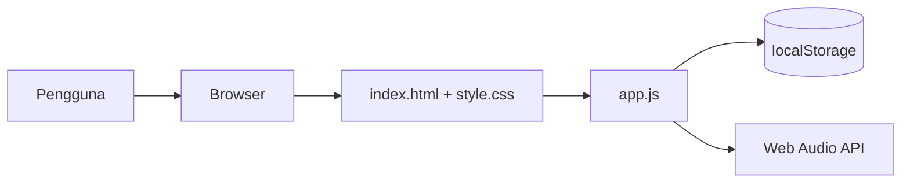

# DragonFocus 🐉

**DragonFocus** adalah aplikasi produktivitas bertema naga luar angkasa yang menggabungkan **Pomodoro Timer** dengan **Quest Board** (papan tugas). Dibuat murni dengan HTML, CSS, dan JavaScript — tanpa framework, tanpa backend, dan bisa dijalankan sepenuhnya offline.

## 🌐 Live Demo

**https://vibescoderz.pages.dev**

## ✨ Fitur

- **Pomodoro Timer** — sesi fokus, istirahat pendek, dan istirahat panjang yang bisa dikonfigurasi.
- **Quest Board** — tambah, tandai selesai, dan hapus tugas harian.
- **Active Task** — pilih satu tugas sebagai fokus utama saat sesi berjalan.
- **Mascot Naga** — maskot animasi yang memberi semangat sesuai kondisi sesi.
- **Ambient Sound** — suara latar (hujan/api) dengan pengatur volume, dibuat lewat Web Audio API.
- **Progress Bar** — visualisasi progres sesi fokus.
- **Penyimpanan Lokal** — tugas dan pengaturan disimpan di `localStorage` (tidak perlu akun).
- **Responsif** — nyaman dipakai di desktop maupun ponsel.

## 🏗️ Arsitektur



Aplikasi ini sepenuhnya client-side (static site). Tidak ada API route, database, atau server-side rendering.

## 📁 Struktur Proyek

```
index.html   # Markup utama aplikasi
style.css    # Tema "Dragon in Space", animasi, dan layout responsif
app.js       # Logika timer, quest board, ambient sound, maskot
dragon.png   # Aset maskot naga
dist/        # Hasil build statis untuk deployment (di-generate, tidak di-commit)
```

> Catatan: file `.tsx` dan konfigurasi Next.js di repo ini adalah sisa eksperimen
> sebelumnya. Aplikasi yang berjalan dan di-deploy adalah versi statis
> `index.html` + `style.css` + `app.js`.

## 🚀 Menjalankan Secara Lokal

```bash
# Opsi 1: buka langsung
xdg-open index.html   # Linux
open index.html       # macOS

# Opsi 2: jalankan static server
python3 -m http.server 8080
# lalu buka http://localhost:8080
```

## 🚢 Deployment

Di-deploy ke **Cloudflare Pages** sebagai static site:

```bash
mkdir -p dist
cp index.html style.css app.js dragon.png dist/
npx wrangler pages deploy dist --project-name vibescoderz
```

## 📄 Lisensi

MIT — lihat [LICENSE](./LICENSE).

---

_Dikembangkan oleh **dezzorigin** (Nabil Aulia Dika)._
